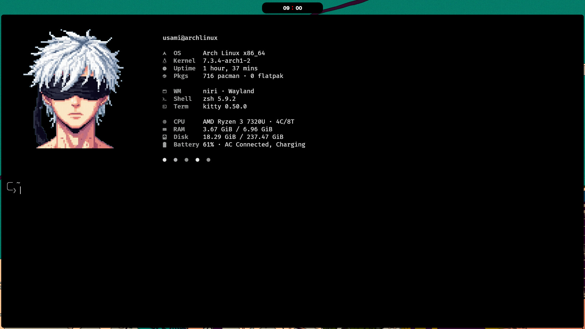

# Sabari’s dotfiles

A monochrome Arch Linux desktop with Hyprland, a custom Quickshell shell, and a terminal-based workflow.

## Desktop showcase

[Watch on YouTube](https://youtu.be/RfIYW371o9A)

The Quickshell island brings together workspaces, an app launcher, clipboard history, a dashboard, notifications, connectivity controls, and a wallpaper picker.

Neovim and tmux share a transparent, monochrome setup.

## The setup

| Component | Config |
| --- | --- |
| Compositor | [Hyprland integration](config/hypr/quickshell.lua) · [niri config](config/niri/config.kdl) |
| Desktop shell | [Quickshell](config/quickshell/shell.qml) |
| Terminals | [Kitty](config/kitty/) · [Alacritty](config/alacritty/) |
| Editor | [Neovim](config/nvim/) · [Code - OSS](config/Code%20-%20OSS/User/settings.json) |
| Multiplexer | [tmux](config/tmux/) |
| System info | [Fastfetch](config/fastfetch/) |
| Wallpapers | [Collection](wallpapers/) |

## Install on Arch Linux

Install Quickshell and the packages used by the Hyprland setup. The Lua
integration uses Hyprland 0.55 or newer.

~~~sh
sudo pacman -Syu --needed hyprland quickshell kitty \
  wl-clipboard cliphist imagemagick swaybg matugen cava brightnessctl wlsunset \
  networkmanager nm-connection-editor bluez bluez-utils upower \
  pipewire pipewire-pulse wireplumber ttf-jetbrains-mono-nerd ttf-cascadia-code-nerd
~~~

The Wi-Fi and Bluetooth panels use NetworkManager and BlueZ. If you use these
services, start them with `sudo systemctl enable --now NetworkManager.service`
and `sudo systemctl enable --now bluetooth.service`, respectively.

Install Neovim 0.12 or newer, plugin and parser build tools, and the configured
language servers and formatters:

~~~sh
sudo pacman -Syu --needed neovim base-devel git curl tar tree-sitter-cli wl-clipboard \
  qt6-declarative stylua go gopls lua-language-server marksman rust-analyzer
~~~

`qt6-declarative` provides `qmlls` and `qmlformat`. See the
[Neovim guide](config/nvim/README.md) for mappings and tools.

### Activate the configs

From the repository root, move any existing `quickshell` and `nvim`
configs out of your config directory before linking. Changes to linked files
apply directly to the active setup.

~~~sh
config_home="${XDG_CONFIG_HOME:-$HOME/.config}"
mkdir -p "$config_home/hypr"
for config in quickshell nvim; do
  ln -sT -- "$PWD/config/$config" "$config_home/$config"
done
ln -sT -- "$PWD/config/hypr/quickshell.lua" "$config_home/hypr/quickshell.lua"
~~~

Add this line to your existing `hypr/hyprland.lua`:

~~~lua
dofile((os.getenv("XDG_CONFIG_HOME") or os.getenv("HOME") .. "/.config") .. "/hypr/quickshell.lua")
~~~

Hyprland starts Quickshell at the next login. To start it in the current
session, run `hyprctl reload` and then `quickshell -n` if it isn't already running.
Quickshell starts its own clipboard watcher.

To use the included images in the wallpaper picker, link the collection
if you don't already have a `~/Pictures/Wallpapers` directory:

~~~sh
mkdir -p "$HOME/Pictures"
ln -sT -- "$PWD/wallpapers" "$HOME/Pictures/Wallpapers"
~~~

Install the pinned Neovim plugins after linking the config:

~~~sh
nvim --headless -u NONE -l config/nvim/scripts/bootstrap.lua
~~~

Open `nvim` to install the Treesitter parsers. Use `:Mason` for additional tools.

## Other configs

- **tmux:** run `git submodule update --init` from this repository to initialize plugins.
- **Code - OSS:** install One Dark Pro, Material Icon Theme, Material Product Icons, and Vim from the Extensions view.
- **Zsh and Fastfetch:** included as source configs; activation is manual.

Everyday shortcuts

| Keys | Action |
| --- | --- |
| `Super + Space` | Toggle the app launcher |
| `Super + Shift + V` | Toggle clipboard history in Hyprland |
| `Super + W` | Toggle the wallpaper picker |
| `Super + Shift + N` | Toggle focus mode |
| `Super + L` | Lock the screen |
| `Space` in Neovim | Leader key |
| Backtick in tmux | Prefix key |
| Prefix + `\|` / `-` | Split tmux panes |
| Prefix + `r` | Reload tmux config |
| Prefix + `f` | Project / session picker |
| Prefix + `Ctrl + t` | Bash popup |

Tmux clipboard integration uses `wl-copy`. Extra pickers and shortcuts may need
`sesh`, `gum`, `fzf`, `fd`, `yazi`, `lazygit`, or `rmpc`.

