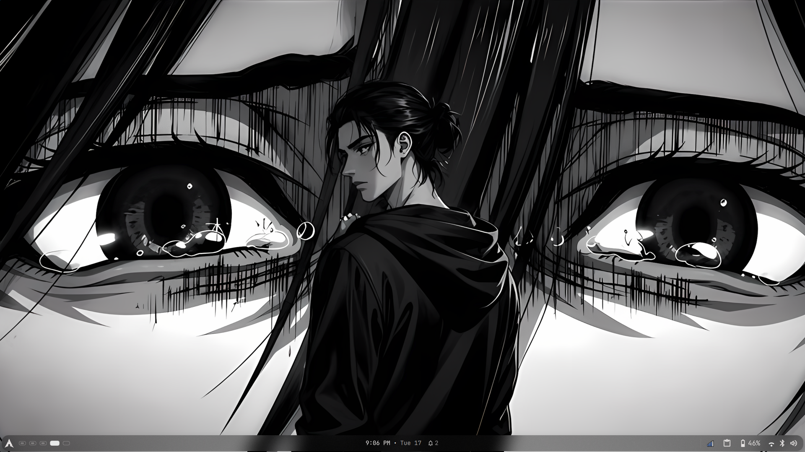
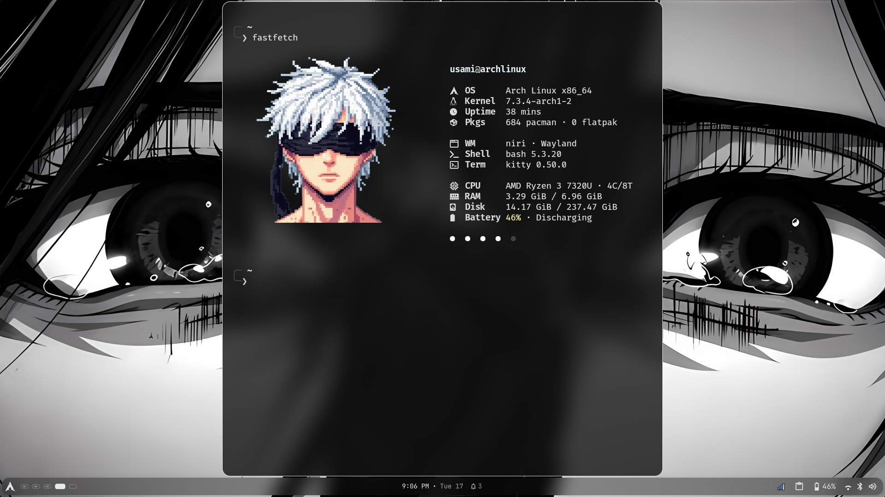

# Sabari’s dotfiles

A minimal Arch Linux desktop with niri, DankMaterialShell, and a monochrome theme.



## The setup

| Component | Config |
| --- | --- |
| Compositor | [niri](config/niri/config.kdl) |
| Desktop shell | [DankMaterialShell](config/dms/) |
| Terminals | [Kitty](config/kitty/) · [Alacritty](config/alacritty/) |
| Editor | [Neovim](config/nvim/) · [Code - OSS](config/Code%20-%20OSS/User/settings.json) |
| Multiplexer | [tmux](config/tmux/) |
| System info | [Fastfetch](config/fastfetch/) |
| Wallpapers | [Collection](wallpapers/) |

## A closer look

**Neovim + tmux** — transparent editor, split panes, and a black-and-white status line.


**Fastfetch** — system details with a custom Gojo image.



## Setup notes

These are personal configs, with selected files linked into `~/.config`.
Back up your existing configs and review paths before linking or copying them.
Changes to linked files apply directly to the active setup.

- **Desktop:** see the [DMS restore guide](config/dms/README.md). Check niri changes with `niri validate`.
- **Neovim:** requires Neovim 0.12 for native `vim.pack` support. See the [editor guide](config/nvim/README.md) for mappings and tools.
- **tmux:** run `git submodule update --init` from this repository to initialize plugins.
- **Code - OSS:** install One Dark Pro, Material Icon Theme, Material Product Icons, and Vim from the Extensions view.
- **Zsh and Fastfetch:** included as source configs; activation is manual.

Install the pinned Neovim plugins from the repository root:

```sh
nvim --headless -u NONE -l config/nvim/scripts/bootstrap.lua
```

Treesitter installs parsers on first launch. Use `:Mason` to install language
servers and formatters; Qt’s `qmlls` and `qmlformat` are installed separately.

## Everyday keys

| Keys | Action |
| --- | --- |
| `Super + T` | Open Kitty |
| `Space` in Neovim | Leader key |
| Backtick in tmux | Prefix key |
| Prefix + `\|` / `-` | Split tmux panes |
| Prefix + `r` | Reload tmux config |
| Prefix + `f` | Project / session picker |
| Prefix + `Ctrl + t` | Bash popup |

Tmux clipboard integration uses `wl-copy`. Extra pickers and shortcuts may need
`sesh`, `gum`, `fzf`, `fd`, `yazi`, `lazygit`, or `rmpc`.
