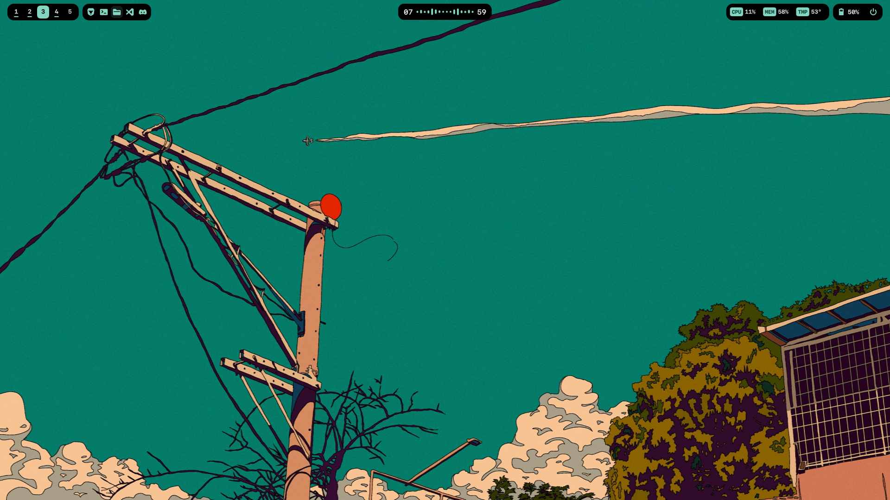
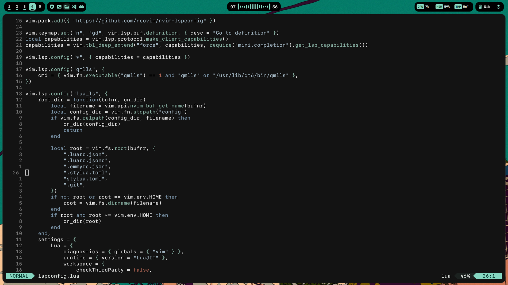
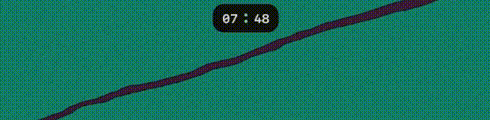

# Sabari’s dotfiles

A monochrome Arch Linux desktop with Hyprland, a custom Quickshell shell, and a terminal-based workflow.

## Desktop showcase

[Watch on YouTube](https://youtu.be/RfIYW371o9A)

The Quickshell island brings together workspaces, an app launcher, clipboard history, a dashboard, notifications, connectivity controls, and a wallpaper picker.

[App launcher](assets/app_launcher.png) · [Wallpaper picker](assets/wallpaper_picker.png) · [Terminal tools](assets/tools.png)

Neovim and tmux share a transparent, monochrome setup.

## The setup

| Component | Config |
| --- | --- |
| Compositor | [Hyprland](config/hypr/hyprland.lua) |
| Desktop shell | [Quickshell](config/quickshell/shell.qml) |
| Terminals | [Kitty](config/kitty/) |
| Editor | [Neovim](config/nvim/) · [Code - OSS](config/Code%20-%20OSS/User/settings.json) |
| Multiplexer | [tmux](config/tmux/) |
| System info | [Fastfetch](config/fastfetch/) |
| Wallpapers | [Collection](wallpapers/) |

## Install on Arch Linux

Install Quickshell and the packages used by the Hyprland setup. The Lua
integration uses Hyprland 0.55 or newer.

~~~sh
sudo pacman -Syu --needed hyprland quickshell kitty starship python adwaita-icon-theme \
  wl-clipboard cliphist imagemagick swaybg matugen cava brightnessctl wlsunset \
  networkmanager nm-connection-editor bluez bluez-utils upower \
  pipewire pipewire-pulse wireplumber ttf-jetbrains-mono-nerd ttf-cascadia-code-nerd
~~~

The Wi-Fi and Bluetooth panels use NetworkManager and BlueZ. If you use these
services, start them with `sudo systemctl enable --now NetworkManager.service`
and `sudo systemctl enable --now bluetooth.service`, respectively.

Install Neovim 0.12 or newer, plugin and parser build tools, and the configured
language servers and formatters:

~~~sh
sudo pacman -Syu --needed neovim base-devel git curl tar tree-sitter-cli wl-clipboard \
  qt6-declarative stylua go gopls lua-language-server marksman rust-analyzer
~~~

`qt6-declarative` provides `qmlls` and `qmlformat`. See the
[Neovim guide](config/nvim/README.md) for mappings and tools.

### Activate the configs

From the repository root, move any existing configs you plan to replace out
of your config directory before linking. Edits to linked files apply directly
to the active setup. Review the monitor layout in
[monitors.lua](config/hypr/conf/monitors.lua) before activating the Hyprland config.

~~~sh
config_home="${XDG_CONFIG_HOME:-$HOME/.config}"
mkdir -p "$config_home"
for config in bash hypr kitty quickshell nvim tmux; do
  ln -sT -- "$PWD/config/$config" "$config_home/$config"
done
~~~

If you keep your own Hyprland config, link `config/hypr/quickshell.lua`
into your Hyprland config directory and load it from `hyprland.lua`:

~~~lua
dofile((os.getenv("XDG_CONFIG_HOME") or os.getenv("HOME") .. "/.config") .. "/hypr/quickshell.lua")
~~~

Hyprland starts Quickshell at the next login. To start it in the current
session, run `hyprctl reload` and then `quickshell -n` if it isn't already running.
Quickshell starts its own clipboard watcher.

To use the included images in the wallpaper picker, link the collection
if you don't already have a `~/Pictures/Wallpapers` directory:

~~~sh
mkdir -p "$HOME/Pictures"
ln -sT -- "$PWD/wallpapers" "$HOME/Pictures/Wallpapers"
~~~

Install the pinned Neovim plugins after linking the config:

~~~sh
nvim --headless -u NONE -l config/nvim/scripts/bootstrap.lua
~~~

Open `nvim` to install the Treesitter parsers. Use `:Mason` for additional tools.

### Wallpaper colors

Select a wallpaper in Quickshell before setting up the watcher. From the
repository root, move any existing Matugen config and conflicting destination
files aside before running these commands. The watcher instance uses the
running Quickshell configuration’s shell ID.

~~~sh
config_home="${XDG_CONFIG_HOME:-$HOME/.config}"
state_home="${XDG_STATE_HOME:-$HOME/.local/state}"
unit_dir="$config_home/systemd/user"
mkdir -p "$unit_dir"

ln -sT -- "$PWD/config/matugen" "$config_home/matugen"
for unit in path service; do
  ln -sT -- "$PWD/config/systemd/user/matugen-wallpaper@.$unit" \
    "$unit_dir/matugen-wallpaper@.$unit"
done

shell_id=$(quickshell list -j | python3 -c 'import json, sys; print(json.load(sys.stdin)[0]["shell_id"])')
wallpaper_state="$state_home/quickshell/by-shell/$shell_id/wallpaper.json"
instance=$(systemd-escape --path "$wallpaper_state")
systemctl --user daemon-reload
systemctl --user enable --now "matugen-wallpaper@$instance.path"
systemctl --user start "matugen-wallpaper@$instance.service"
~~~

If you're migrating from the old `matugen-wallpaper.path` unit, disable it
before enabling the new instance.

Link the generated Starship and Fastfetch configs and the folder icon theme
after generation succeeds. Adjust the existing GTK settings if you already
have files at those destinations.

~~~sh
icon_dir="${XDG_DATA_HOME:-$HOME/.local/share}/icons"
mkdir -p "$icon_dir" "$config_home/fastfetch" "$config_home/gtk-3.0" "$config_home/gtk-4.0"
ln -sT -- matugen/generated/starship.toml "$config_home/starship.toml"
ln -sT -- ../matugen/generated/fastfetch.jsonc "$config_home/fastfetch/config.jsonc"
ln -sT -- "$PWD/config/fastfetch/gojo.png" "$config_home/fastfetch/gojo.png"
ln -sT -- "$config_home/matugen/generated/icons/Matugen-Folders" "$icon_dir/Matugen-Folders"
for gtk in gtk-3.0 gtk-4.0; do
  ln -sT -- "$PWD/config/$gtk/settings.ini" "$config_home/$gtk/settings.ini"
  ln -sT -- "../matugen/generated/$gtk/gtk.css" "$config_home/$gtk/gtk.css"
done
~~~

## Other configs

- **tmux:** run `git submodule update --init` from this repository to initialize plugins.
- **Code - OSS:** install One Dark Pro, Material Icon Theme, Material Product Icons, and Vim from the Extensions view.
- **Zsh and standalone Fastfetch:** activate manually.
- **Rishot:** install it at `~/.local/bin/rishot` for the Hyprland `Super + S` binding and link `config/rishot` to `~/.config/rishot`.

Everyday shortcuts

| Keys | Action |
| --- | --- |
| `Super + Space` | Toggle the app launcher |
| `Super + Shift + V` | Toggle clipboard history in Hyprland |
| `Super + W` | Toggle the wallpaper picker |
| `Super + Shift + N` | Toggle focus mode |
| `Super + L` | Lock the screen |
| `Space` in Neovim | Leader key |
| Backtick in tmux | Prefix key |
| Prefix + `\|` / `-` | Split tmux panes |
| Prefix + `r` | Reload tmux config |
| Prefix + `f` | Project / session picker |
| Prefix + `Ctrl + t` | Bash popup |

Tmux clipboard integration uses `wl-copy`. Extra pickers and shortcuts may need
`sesh`, `gum`, `fzf`, `fd`, `yazi`, `lazygit`, or `rmpc`.

