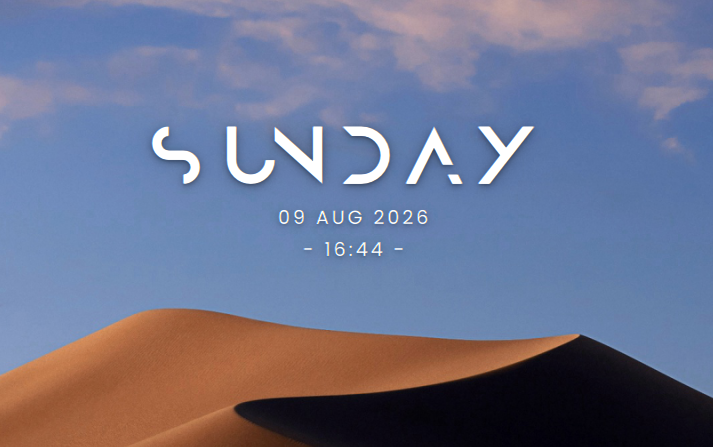

# Modern Clock — a DankMaterialShell desktop widget

A minimal desktop clock: a large day name over the date and time, on a transparent
background with a drop shadow so it stays readable over any wallpaper.



This is a port of [Prayag2's **Modern Clock**](https://github.com/Prayag2/kde_modernclock)
KDE Plasma plasmoid to DMS / Quickshell. That plasmoid is itself a port of the
Rainmeter **Mond** skin. All the original defaults are preserved: day at 72px with
17px tracking in Anurati, date and time at 19px with 3px tracking in Poppins, 5px
line spacing, white text, `dd MMM yyyy`, and a `-` separator around a 12-hour clock.

## Requirements

- DankMaterialShell **1.5.0** or newer (developed against 1.5.3)
- Quickshell with the `QtQuick.Effects` module (ships with Qt 6)

## Install

Clone or copy this directory to your DMS plugin folder:

```bash
git clone https://github.com/beefsizzle/ModernClockDMS.git ~/.config/DankMaterialShell/plugins/ModernClock
```

The repo is named `ModernClockDMS`, but the plugin directory must be `ModernClock`
for DMS to pick it up — hence the explicit target path above.

Then add the widget from **Settings → Widgets & Notifications → Desktop Widgets**
and enable it in the menu below.

After any edit to the QML, reload without restarting the shell:

```bash
dms ipc call plugins reload modernClock
```

## Fonts

Both faces ship in the `fonts/` folder and are used automatically — no setup
needed for the original look:

- **Poppins** (`fonts/Poppins.ttf`) — Poppins Regular, SIL Open Font License 1.1,
  see `fonts/OFL.txt`.
- **Anurati** (`fonts/Anurati.otf`) — by Emmeran Richard, **free for personal use
  only**; commercial use requires the designer's permission. See
  [NOTICE.md](NOTICE.md) for the full provenance notes before redistributing or
  using this plugin commercially.

The **Day Font** and **Date & Time Font** settings are searchable dropdowns
listing every font installed on the system, with *Bundled default* selecting the
faces above. If either bundled file is removed, the widget falls back to the DMS
UI font (with a shell-log warning) rather than breaking.

Anurati has **no lowercase glyphs** — 38 glyphs total, A–Z plus a little
punctuation — which is why *Uppercase Text* defaults to on.

## Settings

| Setting | Default | Notes |
| --- | --- | --- |
| Day Font | Bundled default | Searchable list of every installed font |
| Date & Time Font | Bundled default | Searchable list of every installed font |
| Show Day / Date / Time | on | Each line toggles independently |
| 24-Hour Format | off | Off matches the original (`hh:mm AP`) |
| Show Seconds | off | Switches the clock to second precision |
| Uppercase Text | on | Anurati has no lowercase glyphs |
| Scale With Widget Size | off | See below |
| Use DMS Theme Colors | off | Uses `Theme.surfaceText`, ignoring the pickers |
| Day / Date / Time Color | `#FFFFFF` | Ignored when theme colors are on |
| Separator Character | `-` | Drawn on both sides of the time |
| Date Format | `dd MMM yyyy` | Qt date format string |
| Alignment | center | left / center / right |
| Day Font Size | 72 px | |
| Date & Time Font Size | 19 px | |
| Day / Date / Time Letter Spacing | 17 / 3 / 3 px | |
| Drop Shadow Strength | 60 % | 0 disables the shadow layer entirely |
| Background Opacity | 0 % | 0 is fully transparent, like the original |

### Scale with widget size

Desktop widgets are resizable, so the fixed 72/19/19 sizes only look right at one
size. With **Scale With Widget Size** on, the three font sizes, the letter spacing
and the line spacing are all derived from the widget's current width against a
640px reference, preserving the original 72 / 19 / 19 proportions. The font-size
and letter-spacing sliders are ignored while it is on.

## Credits

- Original plasmoid: [Prayag2/kde_modernclock](https://github.com/Prayag2/kde_modernclock) (GPL-3.0)
- Original design: the [Mond](https://www.deviantart.com/koffiedev/art/Mond-767620271) Rainmeter skin
- Poppins by Indian Type Foundry, Jonny Pinhorn (SIL OFL 1.1)
- Anurati by Emmeran Richard (free for personal use — see [NOTICE.md](NOTICE.md))

## License

The plugin code is GPL-3.0, matching the original plasmoid — see [LICENSE](LICENSE).

The bundled fonts are **not** GPL and carry their own terms: Poppins is under the
SIL OFL 1.1, which permits redistribution; Anurati is free for personal use only,
which does not sit comfortably alongside GPL-3.0 in a single distributed package.
It is bundled here for convenience and parity with the upstream plasmoid, which
does the same. If that matters for your use — commercial deployment, packaging,
or redistribution — delete `fonts/Anurati.otf` and pick a Day Font from the
dropdown instead; the widget handles the missing file gracefully. See
[NOTICE.md](NOTICE.md) for the full provenance.
